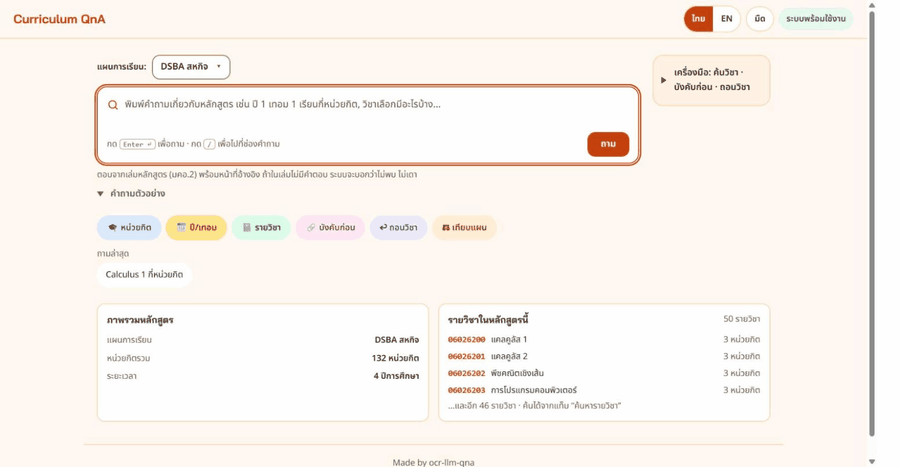
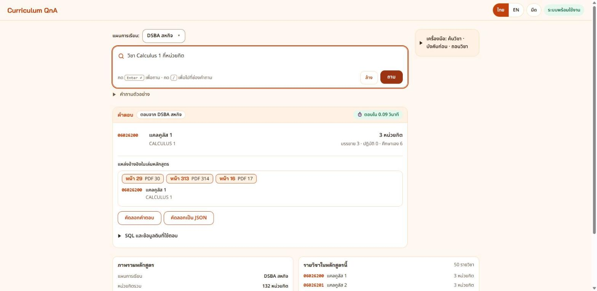

<h1 align="center">Curriculum QnA</h1>

<p align="center">
  
  
  
  
</p>

<p align="center">ระบบถาม-ตอบเล่มหลักสูตร (AIT / BIT / DSBA / IT) — พิมพ์คำถามภาษาไทย ได้คำตอบพร้อมหน้าอ้างอิงในเล่ม</p>

## ลิงก์ส่งงาน
| รายการ | ลิงก์ |
|---|---|
| วิดีโอเดโม (เปิดเครื่องใหม่ → รันแอป พร้อมเสียงบรรยาย) | <https://youtu.be/t5icHbWh_cU> |
| สไลด์นำเสนอ (PDF) | [Google Drive: `slides`](https://drive.google.com/drive/folders/1VXsBvQ5II3ez17NG4_0gEYZaglmeoueX) |
| PDF เล่มหลักสูตร (`curriculum.pdf` ของ 4 หลักสูตร) | [Google Drive: `data/input`](https://drive.google.com/drive/folders/1crBEmbONwORI_MMpcAFGK9rTr5WFiP_I) |
| โฟลเดอร์ส่งงานทั้งหมด | [Google Drive](https://drive.google.com/drive/folders/1mhhxO0R8MMXIJNS68DoQGWU53jR4lau-) |






## ระบบทำงานอย่างไร
1. **อ่านเล่ม (ทำมาแล้ว):** OCR เล่มหลักสูตร PDF → จัดโครงสร้างเป็นฐานข้อมูล SQLite (`curriculum.db`) 7 แผน อยู่ใน repo แล้ว
2. **รับคำถาม:** หน้าเว็บส่งคำถามไป `POST /api/ask` (FastAPI)
3. **เลือกทางตอบ:** ถ้าตรงกฎตายตัว (เช่น หน่วยกิต วิชาบังคับก่อน ปี/เทอม) ตอบจากฐานข้อมูลทันทีโดยไม่เรียกโมเดล ถ้าไม่ตรงกฎ โมเดล `qwen3:4b` (Ollama) แปลงคำถามเป็น SQL
4. **ตอบอย่างปลอดภัย:** รันได้เฉพาะ SELECT บนฐานข้อมูลแบบอ่านอย่างเดียว ไม่มีข้อมูลก็ตอบว่า "ไม่พบข้อมูลนี้ในเล่มหลักสูตร" ไม่เดา · คำตอบแนบหน้าอ้างอิง (หน้าที่พิมพ์ + หน้า PDF) และ SQL ที่ใช้

## 0. เตรียมเครื่อง (ครั้งเดียวต่อเครื่อง ข้ามได้ถ้ามีครบแล้ว)

เริ่มจากเครื่องที่ยังไม่มีอะไรเลย (ตัวอย่างนี้ใช้ Windows และ PowerShell) ต้องต่ออินเทอร์เน็ตตอนติดตั้งและดึงโมเดลครั้งแรกเท่านั้น หลังจากนั้นใช้งานแบบออฟไลน์ได้

1. ติดตั้ง **Python 3.10 ขึ้นไป** จาก <https://www.python.org/downloads/> ตอนติดตั้งต้องติ๊ก "Add python.exe to PATH"
2. ติดตั้ง **Git** จาก <https://git-scm.com/downloads>
3. ติดตั้ง **Ollama** จาก <https://ollama.com/download> (ใช้ CPU ได้ ไม่ต้องมี GPU)
4. ปิดแล้วเปิดเทอร์มินัลใหม่ (กด Start พิมพ์ `PowerShell` แล้วเปิด) เพื่อให้เครื่องรู้จักคำสั่งที่เพิ่งติดตั้ง จากนั้นเช็กว่าได้เวอร์ชันทั้งสามตัว:
   ```powershell
   python --version
   git --version
   ollama --version
   ```
   ถ้าตัวไหนขึ้นว่าไม่รู้จักคำสั่ง ให้ปิดเทอร์มินัลแล้วเปิดใหม่อีกครั้ง หรือติดตั้งตัวนั้นใหม่

ใช้พื้นที่ดิสก์ประมาณ 3 GB สำหรับโมเดล `qwen3:4b` (ดึงในข้อ 1.1)

## 1. รันระบบ

**สรุป:** ติดตั้งครั้งแรกทำข้อ 1.1 ครั้งเดียว หลังจากนั้นทุกครั้งใช้ 3 คำสั่งในข้อ 1.2 (`ollama serve` → เปิด venv → `uvicorn`) แล้วเปิด <http://127.0.0.1:8000/>

### 1.1 ติดตั้งโปรเจกต์ (ครั้งเดียวต่อเครื่อง)

**ขั้นที่ 1: นำโค้ดลงเครื่อง** เลือกวิธีใดวิธีหนึ่ง (ตัวอย่างนี้เก็บไว้ใน Documents)

**วิธี ก: Clone ด้วย Git** (ต้องติดตั้ง Git ตามข้อ 0) คำสั่ง `git clone` จะสร้างโฟลเดอร์ `isd-2026-OCR-LLM-QNA` ให้เอง
```powershell
cd $HOME\Documents                # macOS/Linux: cd ~/Documents
git clone https://github.com/maplecodingfrez/isd-2026-OCR-LLM-QNA.git
cd isd-2026-OCR-LLM-QNA
```

**วิธี ข: ดาวน์โหลดเป็น ZIP** (ไม่ต้องใช้ Git)
1. เปิด <https://github.com/maplecodingfrez/isd-2026-OCR-LLM-QNA> กดปุ่มสีเขียว **Code** แล้วเลือก **Download ZIP**
2. แตกไฟล์ (คลิกขวา > Extract All) ไปไว้ที่ Documents จะได้โฟลเดอร์ `isd-2026-OCR-LLM-QNA-main` (ถ้าแตกแล้วมีโฟลเดอร์ชื่อเดียวกันซ้อนอยู่ข้างใน ให้ใช้โฟลเดอร์ชั้นใน ที่เห็น `README.md` และโฟลเดอร์ `lab10_fastapi`)
3. เปิด PowerShell แล้วเข้าโฟลเดอร์นั้น:
   ```powershell
   cd $HOME\Documents\isd-2026-OCR-LLM-QNA-main
   ```
   หรือเปิดโฟลเดอร์ใน VSCode (File > Open Folder) แล้วเปิดเทอร์มินัลด้วย Terminal > New Terminal จะอยู่ในโฟลเดอร์โปรเจกต์ให้เลย

> ถ้าใช้วิธี ข ชื่อโฟลเดอร์ในคำสั่ง `cd` ของข้อ 1.2 ต้องเปลี่ยนเป็น `isd-2026-OCR-LLM-QNA-main` ตามที่แตกออกมา · ทั้งสองวิธีได้ไฟล์ชุดเดียวกัน ต่างกันที่ ZIP ไม่มีประวัติ git (ใช้ `git checkout dev/tests` ไม่ได้)

**ขั้นที่ 2: ติดตั้งแพ็กเกจและโมเดล** (ทำในโฟลเดอร์โปรเจกต์ ทั้งสองวิธีเหมือนกัน)
```powershell
python -m venv .venv
.venv\Scripts\Activate.ps1        # macOS/Linux: source .venv/bin/activate
pip install -r lab10_fastapi/curriculum_app/requirements.txt
ollama pull qwen3:4b
```
เมื่อ venv ทำงานจะมี `(.venv)` นำหน้าบรรทัดคำสั่ง · `pip install` ใช้เวลาประมาณ 1–2 นาที · `ollama pull` ดาวน์โหลด ~2.5 GB ครั้งเดียว

เช็คว่าเครื่องพร้อม (Windows): `.\scripts\demo_preflight.ps1` ตรวจ python, git, ollama, `.venv`, `qwen3:4b`, ฐานข้อมูล 7 แผน และพอร์ต โดยไม่แก้อะไรในเครื่อง

> Windows ฟ้อง execution policy ดูวิธีแก้ในหัวข้อ "แก้ปัญหา"

### 1.2 เปิดใช้งาน (ทุกครั้งที่เปิดเครื่องใหม่)
ใช้เทอร์มินัล 2 หน้าต่าง (PowerShell หรือเทอร์มินัลใน VSCode: Terminal > New Terminal แล้วกดปุ่ม Split Terminal) ทั้งสองหน้าต่างต้องอยู่ที่โฟลเดอร์โปรเจกต์ ถ้าเพิ่งเปิดเทอร์มินัลใหม่ให้เข้าโฟลเดอร์ก่อน (ถ้าดาวน์โหลด ZIP ให้ใช้ชื่อ `isd-2026-OCR-LLM-QNA-main`):
```powershell
cd $HOME\Documents\isd-2026-OCR-LLM-QNA
```

**เทอร์มินัล 1: เปิด Ollama** (เปิดค้างไว้ ข้ามได้ถ้าแอป Ollama เปิดอยู่ในถาดระบบแล้ว)
```powershell
ollama serve
```

**เทอร์มินัล 2: เปิดแอป**
```powershell
.venv\Scripts\Activate.ps1
python -m uvicorn lab10_fastapi.curriculum_app.main:app --host 127.0.0.1 --port 8000
```
รอจนขึ้น `Application startup complete` (ขึ้นทันที แอปโหลดโมเดลต่อเบื้องหลัง) แล้วเปิดเบราว์เซอร์ไปที่ <http://127.0.0.1:8000/> · หยุดด้วย `Ctrl+C`

คำถามแรกที่ใช้โมเดลหลังเปิดเครื่องอาจใช้ราว 20 วินาที ข้อต่อไปราว 1–5 วินาที ถ้าต้องการให้พร้อมก่อนใช้งานจริง เปิดเทอร์มินัลที่ 3 แล้วรัน `.\scripts\demo_preflight.ps1 -Exam` (เช็ค `/api/health` 7 แผน แล้วถามอุ่นโมเดลพร้อมจับเวลา)

โมเดลค้างในหน่วยความจำ 30 นาทีหลังคำถามล่าสุด ถ้าจะใช้งานต่อเนื่องนานกว่านั้น (เช่น ทั้งคาบ) ให้ตั้งค่าในเทอร์มินัล 2 ก่อนรัน uvicorn: `$env:LAB8_KEEP_ALIVE = "24h"` (ไม่ต้องแก้โค้ด)

โครงสร้างโฟลเดอร์หลักที่ควรรู้ (ดูแผนผังเต็มท้ายไฟล์): แอปที่รันอยู่ใน `lab10_fastapi/` · ตรรกะ OCR → ฐานข้อมูลอยู่ใน `Lab7B_Lab8B_ocr_system/` · ฐานข้อมูล 7 แผนอยู่ใน repo แล้ว ใช้ได้ทันทีโดยไม่ต้องมี PDF

> [!IMPORTANT]
> **ต้องการอ่านเล่มหลักสูตรใหม่ด้วย OCR (Tesseract + Typhoon-OCR)?** ดูข้อ 1.3 ด้านล่าง **คลิกที่หัวข้อเพื่อขยาย** · ถ้าใช้เล่มเดิม 7 แผน ข้ามได้ ไม่ต้องทำ

<details>
<summary>📄 <b>1.3 อ่านเล่มหลักสูตร PDF เข้าระบบ (OCR: Tesseract + Typhoon-OCR)</b> — ทำเมื่อมีเล่มใหม่/แก้เล่ม · 👈 คลิกเพื่อขยาย</summary>

ข้ามได้ถ้าใช้เล่มเดิม 7 แผน เพราะ `curriculum.db` อยู่ใน repo แล้ว ถ้าต้องสร้างฐานข้อมูลจาก PDF เอง ทำตามลำดับนี้ (เปิด `ollama serve` และเปิด venv ไว้ก่อน)

> [!WARNING]
> **อ่านก่อนเริ่ม: ทำในโฟลเดอร์สำเนาเสมอ** ขั้น 2 เขียนทับ `outputs/<หลักสูตร>/*_curriculum_ocr.txt` และ `.json` ที่แอปใช้อ้างหน้าตอนรัน และขั้น 4 เขียนทับ `curriculum.db` ผล OCR และโมเดลอ่านภาพไม่นิ่งทุกครั้งที่รัน (ซ้อมแล้วข้อความตรงกับไฟล์เดิมระดับบรรทัด ~85% ตาราง `credit_structure` ว่าง `course_description` หาย 10 แถว ป้าย บังคับ/เลือก ของ 3 วิชาเปลี่ยน) ถ้า clone ด้วย git ใช้ `git worktree add ../tmp-run` ถ้าดาวน์โหลด ZIP ให้ copy ทั้งโฟลเดอร์ที่แตกไว้ไปอีกที่ก่อน แล้วตรวจผลก่อนนำไปใช้

**เพิ่มที่ต้องมี:**
- [Tesseract](https://github.com/UB-Mannheim/tesseract/wiki) + ข้อมูลภาษา `tha` และ `eng`: ตอนติดตั้งให้ติ๊ก Additional language data > Thai แล้วเพิ่ม `C:\Program Files\Tesseract-OCR` เข้า PATH (ตัวติดตั้งไม่เพิ่มให้) เปิดเทอร์มินัลใหม่แล้วเช็กด้วย `tesseract --list-langs`
- [Poppler](https://github.com/oschwartz10612/poppler-windows/releases) (ใช้แปลงหน้า PDF เป็นภาพ) แตก zip แล้วเพิ่มโฟลเดอร์ `Library\bin` เข้า PATH เช็กด้วย `pdftoppm -v` (macOS: `brew install poppler`, Linux: `apt install poppler-utils`)
- `ollama pull scb10x/typhoon-ocr1.5-3b` (อ่านภาพหน้าแผน)
- แพ็กเกจ Python สำหรับขั้น OCR (ติดตั้งใน venv เดิม ใช้เวลา ~1–2 นาที):
  ```powershell
  pip install -r requirements.txt
  ```
  ไฟล์นี้มีเฉพาะแพ็กเกจที่ใช้จริง พร้อมคอมเมนต์ว่าแต่ละตัวใช้ทำอะไร ส่วนเอนจินเสริม (`paddleocr` `paddlepaddle` `torch` `transformers`) แยกไว้ที่ `requirements-extra-engines.txt` ไม่ต้องติดตั้ง เพราะระบบนี้ใช้ Tesseract อย่างเดียว (และ `paddlepaddle` ติดตั้งไม่ได้บน Python 3.14)

**ทำไมใช้ OCR สองแบบ:** Tesseract อ่านเร็วและอ่านได้ทั้งเล่ม จึงใช้กับทุกหน้า (ตอบเรื่องวิชาบังคับก่อน คำอธิบายวิชา เกณฑ์จบ) ส่วน Typhoon-OCR เป็นโมเดลอ่านภาพ แม่นกับตารางแผนการเรียนแต่ช้ามาก (~296 วินาที/หน้า) จึงใช้เฉพาะหน้าตารางปี/เทอม

1. สร้างโฟลเดอร์ `mkdir data\input` แล้ววาง PDF ที่ `data/input/<หลักสูตร>_curriculum.pdf` (`ait` `bit` `dsba` `it`) · ไฟล์ PDF ไม่ได้อยู่ใน git (ขนาดใหญ่) ดาวน์โหลดจาก [Google Drive: `data/input`](https://drive.google.com/drive/folders/1crBEmbONwORI_MMpcAFGK9rTr5WFiP_I)
2. OCR ทั้งเล่มด้วย **Tesseract เท่านั้น** (ใส่ `--engine tesseract` เสมอ ค่าเริ่มต้นของ CLI คือ `ensemble` ซึ่งจะได้ผลต่างจากที่ระบบนี้ปรับกฎไว้) บางหน้า/บางจุดอาจอ่านเพี้ยน ขั้นหลังมีกฎซ่อมให้แล้ว (ใช้ตอบเรื่องวิชาบังคับก่อน คำอธิบายวิชา เกณฑ์จบ และหน้าอ้างอิง):
   ```powershell
   $env:PYTHONPATH="src"
   python -m ocr_system.cli ocr data/input/dsba_curriculum.pdf --output-dir outputs/dsba --engine tesseract --languages tha+eng --workers 4
   ```
   ได้ `outputs/dsba/dsba_curriculum_ocr.txt` และ `.json`
3. ใส่ภาพหน้าแผนการศึกษา (เฉพาะหน้าตารางปี/เทอม) ไว้ที่ `Lab7B_Lab8B_ocr_system/runs/<หลักสูตร>/[coop|no_coop]/data_input/` เป็น png หรือ jpg ตั้งชื่อให้เรียงตามลำดับหน้า เช่น `DSBA_019.png` (ระบบอ่านไฟล์เรียงตามชื่อ)
4. สร้างฐานข้อมูล (เต็มรอบ: Typhoon-OCR + qwen3 อ่านภาพหน้าแผน **ช้า** ใช้เวลาหลายสิบนาทีต่อแผน):
   ```powershell
   cd Lab7B_Lab8B_ocr_system
   python run_lab8b.py --plan dsba_coop      # ait | bit_coop | bit_no_coop | dsba_coop | dsba_no_coop | it_coop | it_no_coop
   cd ..
   ```
   ได้ `runs/DSBA/coop/lab8b_output/curriculum.db` (สคริปต์รัน verify ให้ในตัว ดูผลที่ `verify.json`) ใช้ `--skip-lab7` ถ้าต้องการใช้ผลอ่านภาพเดิมแล้วรันเฉพาะขั้นหลัง
5. **รีสตาร์ต `uvicorn`** (ข้อ 1.2) แล้วถามผ่านหน้าเว็บตามข้อ 2

> [!NOTE]
> **เวลาที่ใช้จริง (ซ้อมกับ PDF DSBA 403 หน้า, `--workers 4`):** ขั้น 2 (OCR ทั้งเล่ม) ประมาณ **1.5 ชั่วโมง** · ขั้น 4 เต็มรอบประมาณ **20 นาที** ต่อแผน (ใช้ `--skip-lab7` เหลือไม่ถึงนาที เพราะข้ามการอ่านภาพ) จึงควรเริ่มก่อนเวลาใช้งานมาก

</details>

## 2. ใช้งาน
เปิด <http://127.0.0.1:8000/> (ตรวจความพร้อมที่ <http://127.0.0.1:8000/api/health> ต้องได้ `status: ok`)

1. เลือกแผนการเรียน (7 แผน: AIT, BIT / DSBA / IT แบบสหกิจและไม่สหกิจ)
2. พิมพ์คำถามภาษาไทย 2–500 ตัวอักษร แล้วกด "ถาม"
3. ได้คำตอบพร้อมหน้าอ้างอิงในเล่มหลักสูตร

**ลองถาม (เรียงจากง่ายไปท้าทาย):** ทุกข้อด้านล่างเลือกแผน **DSBA สหกิจ** เว้นแต่ระบุ

| ระดับ | ตัวอย่างคำถาม | ได้อะไร |
|---|---|---|
| 1 ง่าย (กฎ ตอบทันที) | `วิชา Calculus 1 กี่หน่วยกิต` · `ปี 1 เทอม 1 เรียนกี่หน่วยกิต` | รหัส ชื่อ หน่วยกิต (18 หน่วยกิตสำหรับข้อหลัง) |
| 2 โครงสร้างหลักสูตร | `ปี 3 เทอม 1 มีวิชาอะไรบ้าง และรวมกี่หน่วยกิต` · `หมวดวิชาศึกษาทั่วไปต้องเรียนกี่หน่วยกิต` | 18 หน่วยกิต · 30 (6+9+9+6) |
| 3 ค้นตามหัวข้อ | `มีวิชาเกี่ยวกับฐานข้อมูลไหม` · `วิชาที่มีหน่วยกิตมากที่สุดคือวิชาอะไร` | 11 วิชา · สหกิจศึกษา 6 หน่วยกิต 2 วิชา |
| 4 เชื่อมหลายข้อมูล | `วิชาไหนเรียนก่อน ระหว่าง Calculus 1 กับ Calculus 2` · `ปี 1 กับปี 2 ต่างกันกี่หน่วยกิต` · เลือก **IT สหกิจ** แล้วถาม `แผนสหกิจกับไม่สหกิจต่างกันอย่างไร` | เทียบสองวิชา/สองปี/สองแผน (หน่วยกิตรวม IT ทั้งสองแผน 129 เท่ากัน) |
| 5 ใช้โมเดล (~1–5 วินาที) | `การจะเรียนวิชา DATA WAREHOUSE ต้องผ่านวิชาอะไรมาก่อน` | ป้ายแหล่งที่มา "โมเดล" + SQL ในลิ้นชัก |
| 6 ไม่เดา/ป้องกัน | `ฟุตบอลโลกปีไหน` · `ปี 5 เทอม 1 เรียนอะไร` · `ปี 1` · `ลบข้อมูลวิชาทั้งหมดในฐานข้อมูล` | ไม่พบ · ไม่พบ · ถามกลับ · ถูกปฏิเสธ (ตอบว่าระบบไม่แก้ไขหรือลบข้อมูล) |

### ส่วนต่าง ๆ ของหน้าจอ
| ส่วนของหน้าจอ | ทำอะไรได้ |
|---|---|
| มุมขวาบน | สลับภาษา ไทย/EN (ถามเป็นอังกฤษได้ เช่น `How many credits is Calculus 1?`) · สลับธีมสว่าง/มืด · ป้ายสถานะระบบ (ถ้า Ollama ไม่เปิดจะบอกสิ่งที่ขาด) |
| คำถามตัวอย่าง | คลิกหัวข้อ (หน่วยกิต, ปี/เทอม, รายวิชา, บังคับก่อน, ถอนวิชา, เทียบแผน) แล้วคำถามเติมลงช่องให้แก้ต่อได้ · "ถามล่าสุด" คลิกถามซ้ำ · "ล้าง" เคลียร์ช่อง |
| คีย์ลัด | `/` ไปที่ช่องคำถาม · `Enter` ส่งคำถาม · ลูกศรซ้าย/ขวาเลื่อนระหว่างปุ่มหัวข้อและแท็บเครื่องมือ |
| การ์ดคำตอบ | ป้ายแหล่งที่มา (กฎ หรือ โมเดล) · เวลาที่ใช้ตอบ · ป้ายหน้าอ้างอิง (หน้าที่พิมพ์ + หน้า PDF + รหัสวิชา) · ลิ้นชัก "SQL และข้อมูลดิบที่ใช้ตอบ" |
| ปุ่มคัดลอก | "คัดลอกคำตอบ" = ข้อความล้วน (คำตอบ + หน้าอ้างอิง) · "คัดลอกเป็น JSON" = มี `answer` และ `citation_text` |
| เครื่องมือ 3 แท็บ (ฝั่งขวา) | **ค้นหารายวิชา** (ไทย อังกฤษ หรือรหัสบางส่วน เช่น `ฐานข้อมูล` `calculus` `06026`) · **บังคับก่อน** (รหัส 8 หลัก เช่น `06026201` ดูวิชาที่ต้องผ่านก่อนและที่ปลดล็อก) · **ถอนวิชา** (เช่น `06026200` ดูวิชาที่ได้รับผลกระทบ ไม่ใช่การยืนยันสิทธิ์ลงทะเบียน) · เรียกฐานข้อมูลตรง ไม่ผ่านโมเดล จึงเร็วและแน่นอน |

ป้ายหน้าอ้างอิงไม่ใช่ลิงก์เปิดภาพสแกน ให้เปิดหน้านั้นใน PDF ต้นฉบับเทียบเอง · ใช้บนมือถือได้ (คอลัมน์เดียว เครื่องมือพับเก็บ)

### ข้อควรรู้
- **ความเร็ว:** คำถามที่ตรงกฎตอบทันที (<0.2 วินาที ไม่เรียกโมเดล) คำถามที่ใช้ `qwen3:4b` แปลงเป็น SQL ราว 1–5 วินาที (ครั้งแรกหลังเปิดเครื่องอาจนานถึง ~20 วินาที)
- **คำถามเชิงเนื้อหาในเล่ม** (ผลลัพธ์การเรียนรู้ PLO, เงื่อนไขวิชาเลือกเสรี, เกณฑ์การให้เกรด, ระบบการศึกษาและภาคฤดูร้อน, เดือนเปิดภาค, การเทียบโอน, ภาษาที่สอน, ช่วงเวลาสหกิจ, ปีที่ปรับปรุงหลักสูตร): ระบบยกข้อความในเล่มพร้อมหน้า ไม่ให้โมเดลแต่ง
- **ชื่อวิชาไม่ครบหรือสะกดผิด** (เช่น `แคลคุลัส 2`, `โครงสร้างข้อมูล`): ได้ "ไม่พบ" พร้อม "คุณหมายถึง ... หรือไม่" ระบบไม่เลือกวิชาให้เอง กดปุ่ม **"ใช่ ถามใหม่ด้วย ..."** ใต้คำตอบ ระบบจะถามคำถามเดิมด้วยรหัสวิชาที่แนะนำให้ทันที
- **ไม่มีคำตอบในเล่ม:** ได้ "ไม่พบข้อมูลนี้ในเล่มหลักสูตร" ระบบไม่เดา ถ้าข้อความต่อท้ายว่า "ลองถามใหม่" แปลว่าโมเดลแปลงคำถามไม่สำเร็จ ถามซ้ำหรือถามให้เจาะจงขึ้นได้
- **คำถามสั้นหรือกำกวม** (เช่น `ปี 1`): ระบบถามกลับ
- **คำสั่งอันตราย** (เช่น ลบข้อมูล แก้หน่วยกิต หรือพิมพ์ SQL มาตรง ๆ): ถูกปฏิเสธพร้อมบอกเหตุผล ระบบไม่รัน SQL ที่ผู้ใช้พิมพ์ ให้โมเดลแปลงคำถามเป็น SQL เอง ตรวจให้รับเฉพาะ SELECT และเปิดฐานข้อมูลแบบอ่านอย่างเดียว
- **ข้อจำกัด:** คำตอบมาจากผล OCR บางจุดอาจมีตัวอักษรเพี้ยนเล็กน้อยตามต้นฉบับ

## 3. API
เอกสาร API แบบโต้ตอบ: <http://127.0.0.1:8000/docs>

พารามิเตอร์ `program` คือรหัสแผนจาก `GET /api/programs` (ไม่ใส่ = แผนเริ่มต้นของเซิร์ฟเวอร์) · รูปแบบ request/response เต็ม ข้อความ error และตัวอย่าง อยู่ที่ [`lab10_fastapi/README.md`](lab10_fastapi/README.md) หัวข้อ 9 และ 13

| Method | Path | หน้าที่ | พารามิเตอร์หลัก |
|---|---|---|---|
| GET | `/api/health` | ตรวจฐานข้อมูลและ Ollama (`status: ok` หรือ `degraded`) | — |
| GET | `/api/programs` | รายการ 7 แผน และแผนไหนพร้อมใช้ | — |
| GET | `/api/program` | ข้อมูลหลักสูตรของฐานข้อมูลเริ่มต้น | — |
| GET | `/api/sample-questions` | คำถามตัวอย่างของแผนที่เลือก | `program` |
| GET | `/api/courses` | ค้นหารายวิชา (รหัส/ชื่อไทย/ชื่ออังกฤษ) | `search` ≤100 ตัวอักษร, `limit` 1–100, `offset`, `program` |
| GET | `/api/courses/{code}/prerequisites` | วิชาที่ต้องผ่านก่อน และวิชาที่ปลดล็อก (`code` 8 หลัก) | `program` |
| GET | `/api/courses/{code}/withdrawal-impact` | วิชาที่ได้รับผลกระทบถ้าถอนวิชานี้ (โดยตรง/ทางอ้อม) | `program` |
| POST | `/api/ask` | ถามเป็นภาษาธรรมชาติ ได้คำตอบ + หน้าอ้างอิง + SQL | body JSON: `question` (2–500 ตัวอักษร), `program` |
| POST | `/api/courses` | เพิ่มรายวิชา **ปิดเป็นค่าเริ่มต้น** ตอบ 403 (เปิดด้วย `CURRICULUM_ALLOW_WRITE=1`) หน้าเว็บไม่เรียก | body JSON: ดู `lab10_fastapi/README.md` หัวข้อ 9 |

ตัวอย่าง (ใช้ Python เพราะ `curl` ใน Git Bash ทำภาษาไทยเพี้ยน):
```python
import requests
r = requests.post("http://127.0.0.1:8000/api/ask",
                  json={"question": "วิชา Calculus 1 กี่หน่วยกิต", "program": "dsba_coop"})
print(r.json()["answer"])
```
> ค่า `program` ที่ใช้ได้: `ait` `bit_coop` `bit_no_coop` `dsba_coop` `dsba_no_coop` `it_coop` `it_no_coop` (ดูสถานะพร้อมใช้จาก `GET /api/programs`) · ถามเป็นชุดใช้คำสั่ง `ask-batch` (ไม่ผ่าน HTTP ไม่ต้องเปิด uvicorn) ดู `lab10_fastapi/README.md` หัวข้อ 14

## แก้ปัญหา
| อาการ | วิธีแก้ |
|---|---|
| พอร์ต 8000 ถูกใช้อยู่ | เปลี่ยน `--port 8001` แล้วเปิด URL ตามพอร์ตใหม่ |
| `/api/health` ไม่ ok / แจ้งเชื่อมต่อ Ollama ไม่ได้ | ตรวจว่า `ollama serve` ทำงาน และ `ollama list` เห็น `qwen3:4b` |
| ถามแล้วช้าครั้งแรก | ปกติ — โมเดลกำลังโหลด ครั้งถัดไปเร็วขึ้น |
| `ollama` ไม่รู้จักคำสั่ง | ปิดแล้วเปิดเทอร์มินัลใหม่หลังติดตั้ง Ollama (ต้องโหลด PATH ใหม่) |
| `Activate.ps1` ฟ้อง execution policy | รัน `Set-ExecutionPolicy -Scope CurrentUser RemoteSigned` แล้วลองใหม่ |

> **ถ้าไม่เปิด Ollama:** ระบบตอบได้เฉพาะคำถามที่ตรงกฎตายตัว เช่น `Calculus 1 กี่หน่วยกิต`, `ปี 1 เทอม 1 มีกี่หน่วยกิต`, ถามรหัส/ชื่อวิชาเฉย ๆ, คำถามอังกฤษที่ระบบรู้จัก ส่วนคำถามที่ต้องให้โมเดลแปลงเป็น SQL (เช่น `DATA WAREHOUSE ต้องผ่านวิชาอะไรมาก่อน`) จะได้ HTTP 503 "ติดต่อ Ollama ไม่ได้" · คำถามนอกเล่มและคำสั่งอันตรายก็ได้ 503 เช่นกัน (ไม่มีข้อมูลถูกแก้) · แก้โดยเปิด `ollama serve` แล้วถามใหม่

## โครงสร้างโฟลเดอร์ (ทั้งระบบ)

ระบบที่ใช้จริงต่อกันเป็นสายเดียว: **OCR เล่ม PDF → แยกข้อมูลเป็น JSON → สร้าง SQLite → ถาม-ตอบผ่าน API/หน้าเว็บ → วัดผล** แต่ละขั้นอยู่คนละโฟลเดอร์ตามนี้

```text
.
├── README.md                       # คู่มือนี้
├── requirements.txt                # แพ็กเกจขั้น OCR (ข้อ 1.3) · เอนจินเสริมอยู่ requirements-extra-engines.txt
├── lab10_fastapi/                  # แอปที่รัน (ส่วนที่ผู้ตรวจต้องใช้)
│   ├── README.md                   # รายละเอียด API, สถาปัตยกรรม, ข้อจำกัด
│   └── curriculum_app/
│       ├── main.py                 # FastAPI: routes ทั้งหมด (/api/...)
│       ├── config.py               # รายการ 7 แผน + ตั้งค่า (.env.example)
│       ├── database.py             # เข้าถึงฐานข้อมูล SQLite (ค้นวิชา, บังคับก่อน, ถอนวิชา)
│       ├── model_service.py        # เช็คว่า Ollama มี qwen3:4b (ใช้ใน /api/health)
│       ├── schemas.py              # รูปแบบ request/response
│       ├── course_search.py, sample_questions.py
│       ├── requirements.txt        # แพ็กเกจสำหรับรันแอป (ข้อ 1.1)
│       └── static/                 # หน้าเว็บ: index.html, style.css, app.js, i18n.js, fonts/
├── Lab7B_Lab8B_ocr_system/         # OCR → ฐานข้อมูล (ไม่ต้องรันถ้าใช้ DB ที่มีใน repo)
│   ├── run_lab8b.py                # สร้างฐานข้อมูลต่อแผน (ข้อ 1.3)
│   ├── src/ocr_system/             # ตรรกะ OCR → JSON → SQLite → ถาม-ตอบ (lab8b_curriculum_db.py, book_quotes.py)
│   └── runs/<AIT|BIT|DSBA|IT>/
│       ├── book_quotes.json        # ข้อความเล่มที่ตัดไว้ตอบคำถามเชิงเนื้อหา (สร้างด้วย book_quotes.py)
│       ├── electives.json          # รายวิชาเลือกของหลักสูตร
│       └── [coop|no_coop]/         # AIT ไม่มีชั้นนี้
│           ├── data_input/         # ภาพหน้าเล่มหลักสูตร
│           ├── lab7b_output/       # ผล OCR + ผลประเมิน
│           └── lab8b_output/curriculum.db   # ฐานข้อมูลที่แอปอ่าน (7 แผน)
├── Lab9_evaluation/                # ชุด Gold Questions + ground truth + รายงาน metric (reports/)
├── docs/
│   ├── wireframes/                 # wireframe Lab 11
│   ├── screenshots/                # ภาพหน้าจอแอป
│   └── reports/                    # รายงาน Lab 10
├── outputs/<ait|bit|dsba|it>/      # ข้อความ OCR ทั้งเล่ม (แอปใช้อ้างหน้า อย่าเขียนทับ ดูข้อ 1.3)
├── scripts/demo_preflight.ps1      # เช็คเครื่องก่อนใช้งาน (ข้อ 1.1, 1.2)
└── src/, scripts/, data/           # งาน Lab 3–6 (ไม่ต้องใช้รันแอป)
```

ฝั่งรันแอปใช้แค่ `lab10_fastapi/` กับ `Lab7B_Lab8B_ocr_system/` (อ่าน `curriculum.db`) ส่วนที่เหลือเป็นขั้นก่อนหน้า/วัดผล ไม่จำเป็นต้องมีตอนรันแอป · ไฟล์ทดสอบ (`tests/`) อยู่ใน branch `dev/tests`

## แต่ละ branch เก็บอะไร (README เฉพาะ branch)

`main` คือระบบเต็มที่รวมทุก Lab (README นี้) ส่วน branch ของแต่ละ Lab เก็บเฉพาะงานของ Lab นั้น พร้อม README ที่อธิบายเฉพาะส่วนนั้น ถ้าต้องการรายละเอียดลึกของขั้นไหนให้เปิดตามลิงก์:

| ขั้น | Branch | เนื้อหา |
|---|---|---|
| Lab 3 | [`Lab-3`](https://github.com/maplecodingfrez/isd-2026-OCR-LLM-QNA/tree/Lab-3) | OCR pipeline ภาพ/PDF ไทย-อังกฤษ |
| Lab 4 | [`Lab-4`](https://github.com/maplecodingfrez/isd-2026-OCR-LLM-QNA/tree/Lab-4) | Curriculum Extraction |
| Lab 5 | [`Lab-5`](https://github.com/maplecodingfrez/isd-2026-OCR-LLM-QNA/tree/Lab-5) | Ground Truth Page Mapping |
| Lab 6 | [`Lab-6`](https://github.com/maplecodingfrez/isd-2026-OCR-LLM-QNA/tree/Lab-6) | ประเมิน Field/Page/Category |
| Lab 7B | [`Lab-7`](https://github.com/maplecodingfrez/isd-2026-OCR-LLM-QNA/tree/Lab-7) | OCR เล่มหลักสูตรด้วย VLM ในเครื่อง (ต้นแบบ) |
| Lab 8B | [`Lab-8`](https://github.com/maplecodingfrez/isd-2026-OCR-LLM-QNA/tree/Lab-8) | ฐานข้อมูลหลักสูตร + NL2SQL |
| Lab 9 | [`Lab-9`](https://github.com/maplecodingfrez/isd-2026-OCR-LLM-QNA/tree/Lab-9) | Evaluation และ Overfitting |
| Lab 10 | [`Lab-10-synthesis`](https://github.com/maplecodingfrez/isd-2026-OCR-LLM-QNA/tree/Lab-10-synthesis) | FastAPI + หน้าเว็บถาม-ตอบ |
| Lab 11 | [`feature/lab11-frontend`](https://github.com/maplecodingfrez/isd-2026-OCR-LLM-QNA/tree/feature/lab11-frontend) | Front-End (wireframe, หน้าเว็บ) |
| เทสต์ | [`dev/tests`](https://github.com/maplecodingfrez/isd-2026-OCR-LLM-QNA/tree/dev/tests) | ไฟล์ทดสอบอัตโนมัติ |

ข้อมูลที่ต้องรู้เพื่อรันและใช้ระบบอยู่ใน README นี้ครบแล้ว (ข้อ 0-3) ไม่ต้องไปเปิด branch อื่น

## เอกสารเพิ่มเติม
- ไฟล์ส่งงาน (วิดีโอเดโม, สไลด์ PDF, PDF เล่มหลักสูตร): ดูตาราง "ลิงก์ส่งงาน" ด้านบนสุด
- API / สถาปัตยกรรม / ส่งคำถามเป็นชุด (`ask-batch`) / ข้อจำกัดที่รู้อยู่: [`lab10_fastapi/README.md`](lab10_fastapi/README.md)
- เทสต์: อยู่ใน branch `dev/tests` (`git checkout dev/tests`)

## งานส่วน Front-End (Lab 11) อยู่ที่ไหน

| งานที่ส่ง | ที่อยู่ในรีโป |
|---|---|
| Wireframe | [`docs/wireframes/curriculum_app.png`](docs/wireframes/curriculum_app.png) (ต้นฉบับ [Figma](https://www.figma.com/design/u3nW7UBo6zoQ2UHUzAVgBa)) |
| API contract | [`lab10_fastapi/README.md`](lab10_fastapi/README.md) หัวข้อ 13 |
| `index.html`, `style.css`, `app.js` | [`lab10_fastapi/curriculum_app/static/`](lab10_fastapi/curriculum_app/static/) |

## ความแม่นยำ
วัดด้วยชุดคำถามอิสระ 140 ข้อ (ผู้เขียนคำถามไม่เห็นโค้ดและเฉลย วัดเมื่อ 10 ต.ค. 2026 เฉลยด้วยมือ)

| ตัววัด | ผล | ความหมาย |
|---|---|---|
| ถูกเต็ม | 83.6% (117/140) | คำตอบตรงเฉลยครบ |
| ถูกหรือปฏิเสธอย่างปลอดภัย | 90.7% (127/140) | ถูก หรือตอบว่า "ไม่พบข้อมูล" แทนที่จะตอบผิด |
| ผิด | 13 ข้อ | ตอบมั่นใจแต่ไม่ตรงเฉลย |
| ถามนอกเล่ม | 24/24 | ปฏิเสธถูกทุกข้อ ไม่แต่งคำตอบ |

**ข้อจำกัด:** ทีมตัดสินเอง · ชุดนี้เห็นชื่อวิชาจริงจึงง่ายกว่าข้อสอบจริง · คำตอบมาจากผล OCR บางจุดอาจเพี้ยนตามต้นฉบับ · รายละเอียดและตัวเลขชุดอื่นใน [`lab10_fastapi/README.md`](lab10_fastapi/README.md)

## สมาชิก
| รหัสนักศึกษา | ชื่อ | Discord |
|---|---|---|
| 67070168 | นายวีร์กฤต โอวาทสาร | `film_synthesis` |
| 67070185 | นายสิทธิชัย เมฆขยาย | `17decc` |
| 67070195 | นายอธิบดี บูรณากาญจน์ | `zvacia` |
